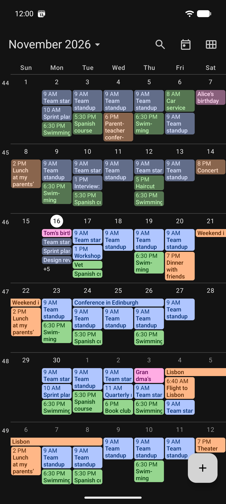
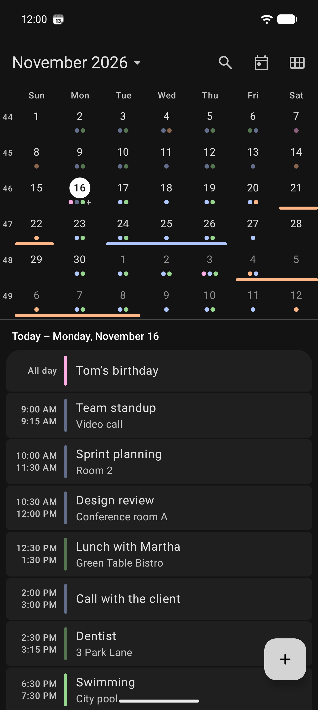
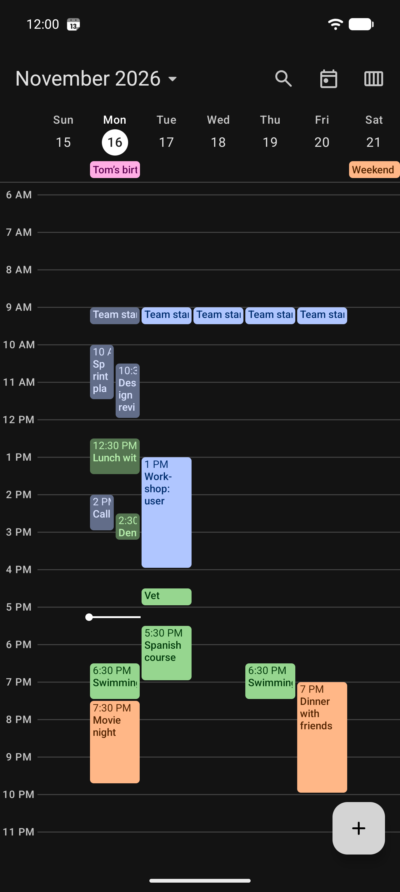
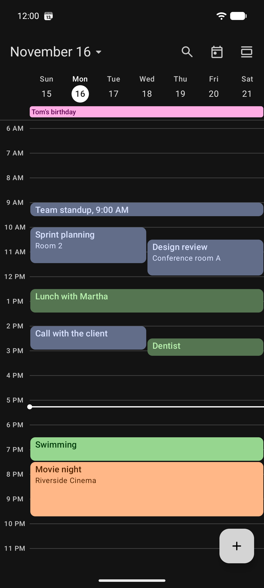
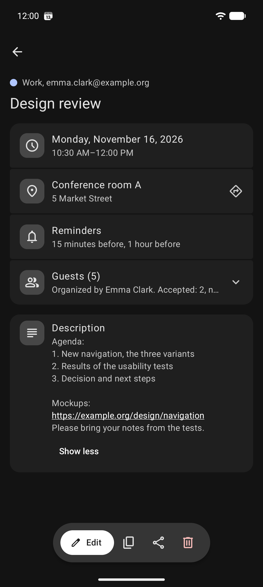
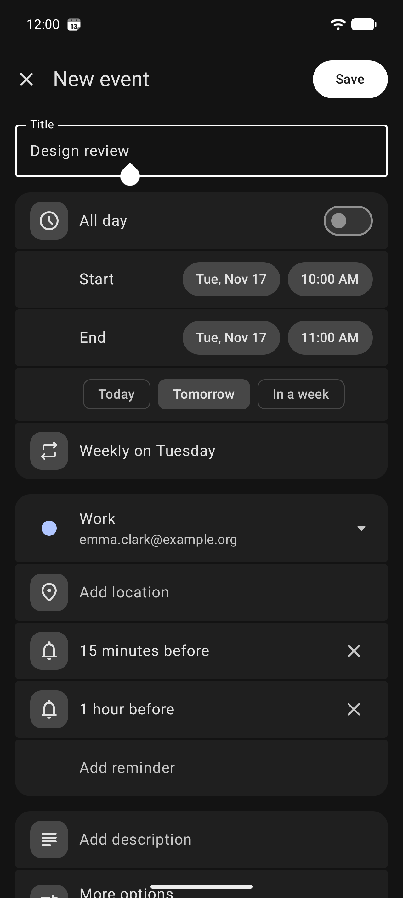

#  Calendar
 
A private calendar for Android: month, week, day and agenda views of the calendars already on your phone, with reminders, repeating events and ICS import, and no Internet access.
 
**Current version**: v0.2.0
 
Source code and releases: [git.hnet.sh/hkr/calendar](https://git.hnet.sh/hkr/calendar)
 
Bug reports and feature requests: [github.com/legal-hkr/calendar](https://github.com/legal-hkr/calendar/issues)
 
## Overview
 
Calendar shows and changes the events kept in the phone’s own calendar storage. It never connects to the Internet: syncing is left to the apps that manage your accounts, for example [DAVx⁵](https://www.davx5.com/) with Nextcloud or any other CalDAV server. No account of its own, no ads, no analytics.
 
## Screenshots
 
     
 
## Features
 
### Views
 
- **Month**: Event tiles with the start time and wrapped titles, or a compact grid with the chosen day’s list; months scroll as one strip of weeks
- **Week and Day**: An all-day strip, overlapping events side by side, a line for the current time, pinch to zoom
- **Agenda**: A list of the days that have events
- **Go to date**: Tap the title; Today is in the top bar

### Events
 
- **Event page**: Location, guests, reminders and description, and your answer to an invitation
- **Editor**: A new event needs only a title; date and time pickers, Today, Tomorrow and In a week, time zone, availability and visibility
- **Repeating events**: Daily, weekly on chosen days, monthly on a day or on “the third Wednesday”, yearly; ending on a date or after a number of occurrences
- **One question**: Changing or deleting a repeating event asks once: only this event, this and following events, or all events
- **Undo**: Deleting takes effect at once and can be undone; events can be duplicated and shared as an ICS file or as text

### Reminders
 
- **On time**: Posted by the app itself at their exact time, even for events synced while the app was closed
- **Actions**: Snooze, and Directions when the event has a location
- **Defaults**: For timed and for all-day events

### Calendars
 
- **Colors**: One of twelve per calendar, and whether it is shown; kept by the app, never written to the account
- **Local calendars**: Create, rename, export to an ICS file, delete
- **ICS import**: Files opened from another app, shared, or picked; one event or many, with events already saved updated instead of duplicated

### Widgets

- **Agenda**: The coming days with their events, as many as fit in the widget; a tap opens the event or the day
- **Next event**: The next event with its time and location
- **Month**: The current month with a dot for each event, up to three a day
- **Upcoming events**: The next event and the one after it, one row high, to fit under a clock widget
- **Without a background**: Upcoming events and Agenda are also available in white text, directly on the wallpaper

### Settings
 
- **View**: The view the app opens with, first day of the week, first hour of the day, week numbers, past and declined events
- **Search**: Titles, locations and descriptions, upcoming or past
- **Backup and restore** of settings and calendar colors to a file you choose
- **Language**: English or Polish, independent of the system language

## Permissions
 
- **Calendar** (read and write): The events themselves
- **Notifications**, **exact alarms** and **run at startup**: Reminders at the right time, even after the phone restarts
- No Internet permission

## Requirements
 
- Android 14 (API level 34) or higher

## Building
 
```bash
git clone https://git.hnet.sh/hkr/calendar.git
cd calendar
./gradlew assembleDebug
```
 
Set the Android SDK path in `local.properties` (`sdk.dir=…`) first. Unit tests run with `./gradlew test`.
 
## Contributing
 
Development happens on [git.hnet.sh](https://git.hnet.sh/hkr/calendar), where the releases are published too. The [GitHub repository](https://github.com/legal-hkr/calendar) is a read-only mirror, updated on every push, and the place to report problems:
 
- **Issues**: Open them on [GitHub](https://github.com/legal-hkr/calendar/issues), with the app version and your Android version
- **Pull requests**: Welcome on GitHub as well, but they can’t be merged there – accepted changes are applied on git.hnet.sh and reach the mirror from there, so the pull request itself ends up closed rather than merged

## Tech stack
 
- **Language**: Kotlin
- **Min SDK**: Android 14 (API 34), **target SDK**: API 37
- **UI**: Jetpack Compose with Material 3 Expressive
- **Data**: The system’s calendar provider (CalendarContract), DataStore

## License
 
[GPL-3.0](https://www.gnu.org/licenses/gpl-3.0.en.html)
 
## Acknowledgments
 
- [Claude](https://claude.ai) by Anthropic – AI assistant that provided valuable support during the development process, helping with code implementation, architecture decisions, and documentation
 